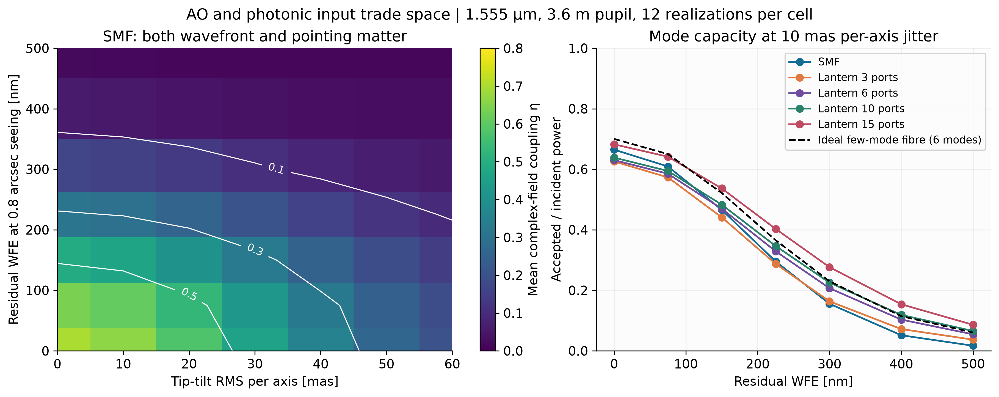

# AO-Photonic Spectrograph Performance Simulator

A reproducible Python simulator linking adaptive-optics wavefront error (WFE), injection jitter and photonic-lantern mode count to fibre coupling, spectral SNR and radial-velocity (RV) precision. This **NIRPS-like, ANDES-inspired conceptual trade study** connects complex wave optics to a synthetic spectroscopic measurement.

**Author: Xu Han** · Independent project in astronomical instrumentation.

> This is an independent conceptual study and is not an official ESO instrument model.

[**Executed notebook**](notebooks/eso_astrophotonics_showcase.ipynb) · [Technical note](docs/technical_note.md) · [Validation report](docs/validation_report.md) · [Reproducibility](docs/reproducibility.md) · [References](docs/references.md)



The core map averages 12 independent realizations per cell at 1.555 µm. The lantern curves assume a 90% transition transmission and an ideal orthonormal modal subspace. Figures are available as [300 dpi PNG](figures/core_design_map.png) and [vector PDF](figures/core_design_map.pdf); uncertainty and detector-cost comparisons appear in the notebook.

**Design findings under the stated assumptions** (single-mode fibre, 1.555 µm, 3.6 m pupil with a 0.25 central obscuration by diameter):

- **Ceiling:** a perfect wavefront couples only **0.70**; the remaining loss is the mismatch between the obscured-pupil Airy field and the Gaussian fibre mode at the assumed 57 mas mode radius.
- **Tolerance:** on the sampled grid, mean coupling stays ≥ 0.5 only for residual WFE ≤ 75 nm combined with tip-tilt jitter ≤ 20 mas per axis (0.53 at that corner). At the 150 nm baseline it is already 0.49 with zero jitter.
- **Stability:** at 150 nm WFE, 40 mas of per-axis jitter halves coupling (0.49 → 0.25), so injection stability is a requirement on a par with AO correction.
- **Mode count:** at 400 nm WFE and 10 mas jitter, a 15-port lantern improves forecast RV precision over the SMF at baseline brightness, but loses at 1/100 brightness, where the extra ports' detector noise and the assumed lantern loss outweigh the extra collected light.

These values are read from [design_map.npz](results/design_map.npz) (12 realizations per cell); standard errors reach 0.02–0.05 at 20–30 mas jitter, so thresholds between grid points are not resolved. The lantern comparison is result 3 under [Reproduced results](#reproduced-results).

## Why this matters for ESO instrumentation

Coupling an AO-corrected focal plane into a photonic input connects optical alignment, wavefront quality, throughput and detector performance. [ESO's NIRPS description](https://www.eso.org/sci/facilities/develop/instruments/NIRPS.html) supplies the 3.6 m aperture, historical HAM resolving-power baseline of 100,000, and three-pixel sampling used as design inspiration. These are historical design choices, not a reconstruction of installed NIRPS performance. [ANDES](https://arxiv.org/abs/2407.14601) motivates the broader ELT-era high-resolution NIR spectroscopy question; this code implements a circular 3.6 m pupil.

The engineering question is what a photonic feed demands before hardware exists: how much AO correction and injection stability it needs, and when a multi-port lantern is worth its extra detector noise. Comparison with a photonic-chip testbench is the next step; see [Testbench extension](#testbench-extension).

## Engineering evidence

| Engineering question | Implemented evidence |
|---|---|
| How do wavefront quality and injection stability set throughput? | Complex-field propagation and coherent modal overlaps; WFE/jitter sweeps with sampling checks and uncertainty estimates in the [executed notebook](notebooks/eso_astrophotonics_showcase.ipynb). |
| When does extra mode capacity justify more detector channels? | Photon, background, dark and read-noise budgets linked to SNR and conditional RV uncertainty; the [port trade study](results/port_trade.json) includes a brightness-dependent reversal. |
| How are the numerical results verified? | Analytic diffraction, energy conservation, statistical ensembles and regression tests, with records bound to the source, inputs and outputs; see the [validation report](docs/validation_report.md). |
| How can another engineer reproduce and extend the work? | A configurable CLI, an installable Python package and a documented [regeneration workflow](docs/reproducibility.md), plus explicit model-to-measurement comparisons below. |

## Reproduced results

<!-- BEGIN GENERATED RESULTS -->
**Validation: 79 tests passed; all 12 notebook code cells executed without errors; 9 PNG/PDF figure pairs exported.** The last complete notebook execution took 32.1 seconds on the validation machine (Python 3.14.3; CPU only). Runtime varies by machine.

| Baseline quantity | Synthetic result |
|---|---:|
| Residual WFE | 150 nm |
| Measured ensemble Strehl (with jitter) | 0.6598 |
| Maréchal cross-check (without jitter) | 0.6926 |
| Mean SMF coupling across band | 0.4711 |
| Mean ideal six-mode acceptance | 0.5303 |
| Mean six-port lantern coupling, after 90% transmission | 0.4772 |
| Median SNR per detector pixel | 144.06 |
| Injected RV | 2300.00 m/s |
| Recovered RV | 2296.37 m/s |
| Recovery error | -3.63 m/s |
| Conditional RV uncertainty (1σ) | 4.12 m/s |
| RV fit reduced χ² (≈1 when model and variance describe the data) | 0.962 |

1. At zero jitter, increasing residual WFE from 0 to 500 nm changes mean SMF coupling from 0.699 to 0.020; wavefront quality sets the photon budget.

2. At 150 nm WFE, increasing per-axis jitter from 0 to 40 mas changes SMF coupling from 0.489 to 0.249; injection stability remains important even at fixed AO residual.

3. At 400 nm WFE / 10 mas jitter, replacing the SMF with a 15-port lantern changes forecast σRV from 12.98 to 8.75 m/s at baseline brightness, but from 403.84 to 502.86 m/s at 1/100 brightness. Under the assumed insertion loss and extraction noise, detector costs can reverse the throughput advantage.
<!-- END GENERATED RESULTS -->

These RV errors are conditional statistical forecasts with an exact template and calibration. They are not predicted NIRPS or ANDES accuracy. A single noisy recovery error does not establish an estimator's ensemble bias.

## Testbench extension

ESO's published [photonic-chip testbench topic](https://www.eso.org/sci/activities/fellowships-and-studentships/engstudentfellow/photonic_chips.html) connects opto-mechanical setup, cameras, line lamps and fibre-fed lasers with the characterisation of photonic spectrographs. Injection scans and line-source measurements could test selected outputs of this simulator. The table separates implemented model capabilities from future experimental work; no bench data have been taken.

| Bench measurement | Model counterpart | Status |
|---|---|---|
| Coupling vs. injection offset (fibre or chip input scanned across the spot) | `propagate(..., tip_tilt_mas=(dx, dy))` with `overlap_efficiency` or `modal_coupling` | Runs now (example below) |
| Coupling vs. imposed aberration (deformable mirror, SLM or phase plate) | Any static OPD map in metres passed to `propagate` | Runs now; aberration maps are user-supplied |
| Coupling vs. wavelength (tunable or fibre-fed laser) | Per-wavelength `propagate`; band nodes in `simulate_optics` | Runs now |
| LSF and resolving power from line-lamp exposures | Constant-R Gaussian LSF with pixel integration | Model only; no line-lamp fitting yet |
| Per-port lantern fluxes, mode-dependent loss | Not modelled: one assumed scalar transmission | Needs a measured transfer matrix |

A static injection-offset scan with the baseline pupil and a flat wavefront:

```python
import numpy as np
from aophoton.config import load_config
from aophoton.pupil import make_pupil
from aophoton.propagation import propagate
from aophoton.coupling import gaussian_mode, overlap_efficiency

cfg = load_config("configs/baseline.yaml")
t, f = cfg.telescope, cfg.fibre
pupil = make_pupil(t.n_pix, t.diameter_m, t.obscuration, t.spider_width_m)
flat = np.zeros_like(pupil.amplitude)
mode = gaussian_mode(propagate(pupil, flat, 1.555, t.pad_factor), f.mode_radius_mas)
for offset_mas in (0, 10, 20, 30, 40, 60):
    focal = propagate(pupil, flat, 1.555, t.pad_factor, (offset_mas, 0.0))
    print(offset_mas, round(overlap_efficiency(focal.field, mode), 3))
# 0 0.699 · 10 0.679 · 20 0.623 · 30 0.538 · 40 0.435 · 60 0.226
```

Offsets are angular on the sky. On a bench they convert to a lateral fibre displacement through the injection relay's effective focal length, which the bench would measure; the model assumes none. The full experimental sequence, including line-lamp dispersion and held-out validation, is in the technical note's [future experimental validation](docs/technical_note.md#future-experimental-validation) section.

## Install and run

Python **3.10 or newer**; CPU only. Clone this standalone repository and create an isolated environment:

```bash
git clone https://github.com/xhvoid/Astrophotonics.git
cd Astrophotonics
python3 -m venv .venv
source .venv/bin/activate
python -m pip install -e '.[dev]'
aophoton simulate --config configs/baseline.yaml
python scripts/run_tests.py
```

The CLI writes `results/baseline/summary.json`, `spectrum.csv`, and `arrays.npz`. The JSON includes the full configuration, every setting's provenance, package versions, Strehl/coupling/SNR and RV results. The CSV includes expected and noisy electrons, their variance, SNR, and wavelength-dependent coupling.

For just the simulation, use `pip install -e .`; FITS support is optional through `.[fits]`. `.[dev]` includes tests, FITS and notebook execution. No downloads are performed by the simulation or notebook.

```bash
# Synthetic zero-noise validation, with a separate output directory:
aophoton simulate --config configs/baseline.yaml --no-noise --output results/noiseless
```

Edit [baseline.yaml](configs/baseline.yaml) to change seeing, WFE, jitter, wavelength, resolution, source brightness or detector terms. Set `fibre.feed` to `smf`, `few_mode`, or `lantern`; configure `lantern_ports` for its spatial capacity. Unknown configuration keys fail explicitly. Imported template paths are relative to the YAML file; formats and observational caveats are described in [public_data.md](docs/public_data.md).

Regenerating the notebook, figures and validation records is described in [reproducibility.md](docs/reproducibility.md).

## Model and scope

```text
Atmosphere → AO residual → complex focal field / PSF → fibre / lantern
           → Gaussian spectrograph LSF → detector electrons → RV fit
```

- **Optics:** circular pupil, configurable obscuration and simplified spiders, reproducible von Kármán screens, scalar residual-RMS AO prescription, pointing offsets, unitary Fraunhofer FFT, monochromatic and incoherent polychromatic PSFs, measured Strehl and extended Maréchal cross-check.
- **Photonic input:** normalized complex overlap with a Gaussian SMF; nested orthonormal Hermite–Gaussian modes approximate ideal few-mode acceptance. Lanterns transmit the accepted subspace with an assumed scalar loss.
- **Spectroscopy:** seeded synthetic absorption lines or explicit ASCII/FITS template, relativistic Doppler injection, constant-R Gaussian LSF, finite pixel integration, staged throughput, Poisson source/background/dark counts and independent read noise.
- **RV:** χ² template matching with a coarse velocity search refined around the lowest minima; local spectral-gradient (Fisher) uncertainty; reduced χ², zero-information and search-boundary diagnostics. Independent lantern outputs add extraction noise while conserving source photons. Search details are in the [technical note](docs/technical_note.md).

All interface units appear in names/docstrings: metres, micrometres, nanometres, arcseconds, milliarcseconds, seconds, electrons and m/s. The complete baseline parameter table labels **sourced**, **assumed** and **illustrative** settings. There are **no fitted instrument parameters**. A sourced default that is changed is relabelled as assumed.

Key assumptions:

1. `residual_wfe_nm` denotes pupil RMS **at the reference seeing**. At fixed assumed AO attenuation, actual WFE scales as `(seeing/reference_seeing)^(5/6)`. At fixed actual WFE, seeing has no separate independent penalty in this model. Screens are periodic, lack subharmonics, and have exactly imposed RMS; they do not simulate an AO controller.
2. Jitter is Gaussian RMS **per axis**; independent frames have no physical cadence. Intensities and coupling powers are averaged, not complex fields. Finite-exposure throughput fluctuations are omitted from spectral variance.
3. The Gaussian radius is an angular 1/e field radius, representing the injection relay. HG modes approximate a parabolic-index guide; port counts are scalar spatial capacities with polarization effects omitted. No physical taper, manufacturing model, modal noise or real fibre cutoff is inferred.
4. The spectrum has an exact continuum/template and wavelength solution. It omits tellurics, stellar variability, instrumental drift, correlated detector noise, saturation, echelle geometry and extraction cross-talk.

An [OOPAOAdapter](src/aophoton/adapters.py) accepts explicitly matched external OPD snapshots. **OOPAO integration and observational validation remain future work.** Ray tracing, full-wave (Maxwell/FDTD) propagation and AO control-loop dynamics are out of scope, and no proprietary data are used.

## Package structure

| Responsibility | Modules / artifacts |
|---|---|
| Configuration, provenance, CLI | `config.py`, `cli.py`, `configs/baseline.yaml` |
| Pupil, phase screens, PSFs | `pupil.py`, `atmosphere.py`, `propagation.py`, `metrics.py` |
| Photonic coupling | `coupling.py`, `lantern.py` |
| Spectrum, LSF, electrons, RV | `spectrum.py`, `spectrograph.py`, `detector.py`, `radial_velocity.py` |
| End-to-end simulation / extension | `simulation.py`, `adapters.py` |
| Scientific validation | `tests/`, `docs/validation_report.md` |
| Executed analysis and outputs | executed notebook, `figures/`, `results/` |

A companion project, the [AO-fed IFU simulator](https://github.com/xhvoid/AO-Fed-IFU-Spectrograph-Simulation), models spaxel coupling with intensity PSFs; this one uses complex focal fields and coherent modal overlaps. The two share no code.

## Reproducibility and contribution

The saved notebook contains the sweep grids, seeds, numerical experiments, figures and computed conclusions. [showcase_metrics.json](results/showcase_metrics.json), [design_map.npz](results/design_map.npz) and [port_trade.json](results/port_trade.json) retain its numerical outputs. [requirements-validated.txt](requirements-validated.txt) records the validated environment; `pyproject.toml` specifies broader supported dependencies. Last-digit equality across different FFT/BLAS versions is not guaranteed. The regeneration steps and how the evidence records are verified are in [reproducibility.md](docs/reproducibility.md).

Core tests compare analytic diffraction, energy conservation, small-error theory, physical bounds and statistical ensembles; they do not merely compare to stored reference outputs. Improvements should add a physically justified validation and update the technical note. Large observational files belong in the ignored `data/` directory, with provenance recorded separately.

[MIT license](LICENSE). Primary equation, instrument and software sources are collected in [references.md](docs/references.md).
